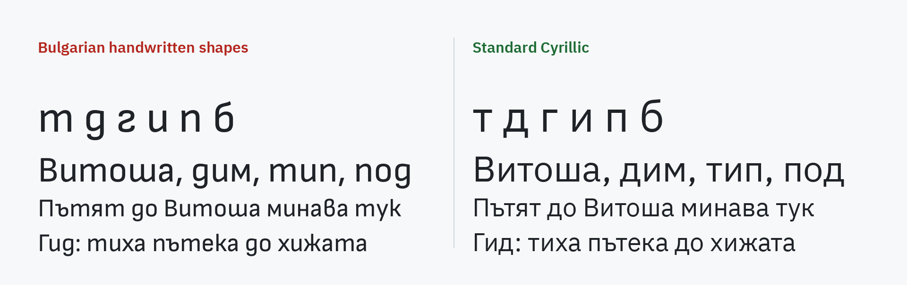

# Standard Cyrillic

A browser extension, for Chrome, Edge and Firefox, that shows Bulgarian
text in the standard Cyrillic letter shapes: т, д, г, и, п as in print, not
the handwritten shapes that look like m, g, s, u and n.

The same text in the handwritten shapes (Sofia Sans, whose Cyrillic has them
as its own letters) and in the standard ones (IBM Plex Sans). On the left,
Витоша reads like "Bumowa", and дим, тип, под like "gum, mun, nog".

Why we made it, and what research says about letters shared by two
alphabets: [WHY.md](WHY.md).

## How it works

The handwritten shapes reach a page in one of two ways:

1. **A font that has them as alternates** (OpenType `locl`), switched on by
   the browser for text marked as Bulgarian (`lang="bg"`). The extension
   switches them off for Bulgarian text.
2. **A web font whose own Cyrillic letters are the handwritten shapes**, as
   some newspapers' custom fonts are. The extension finds such a font by its
   т being as wide as its m, and draws only that font's Cyrillic letters from
   IBM Plex Sans or IBM Plex Serif, sized to the font's x-height. Its Latin
   letters, digits and icons stay as they are.

It is on for every site. The button in the toolbar turns it off for the site
of the tab, and says which fonts it replaced there.

Nothing is collected or sent anywhere. The only permissions are `storage`,
for the sites it is off for, and `activeTab`, for the popup to know the site.

## Install, unpacked

1. Open `chrome://extensions`.
2. Turn on **Developer mode** (top right).
3. **Load unpacked**, and choose this folder.

Pages already open apply it after a reload.

## A site it does not fix

Open an issue with the address of the page and a word that still shows the
handwritten shapes. The font the site uses is usually all that is needed to
fix it.

## Building the store packages

`./make-zips.sh` writes, next to this folder, the package for the Chrome Web
Store and Edge Add-ons and the one for Firefox Add-ons, whose manifest adds
its add-on ID and its declaration that it collects no data. `store/` holds
the text and the images of the three listings.

## Known limits

- A variable web font, one face for a range of weights, gets Plex in four
  weights, Light, Regular, SemiBold and Bold, each for its part of the
  range, so its bold text stays bold.
- Switching off `locl` with `font-feature-settings` also switches off other
  OpenType features a site set on Bulgarian text, such as tabular figures.
- A font loads as text needs it, so the first moment of a page may show the
  handwritten shapes before they are replaced.

## Fonts

`fonts/` holds IBM Plex Sans and IBM Plex Serif, Cyrillic only (U+0400 to
U+04FF), under the SIL Open Font License (`fonts/OFL.txt`).

## License

The code is under the MIT License (`LICENSE`). The fonts keep their own,
the SIL Open Font License.
